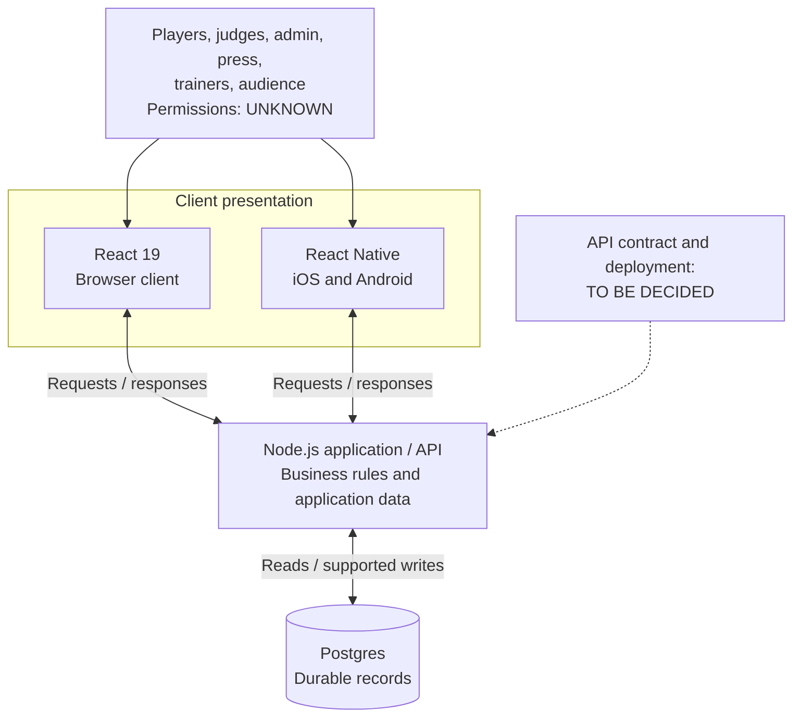
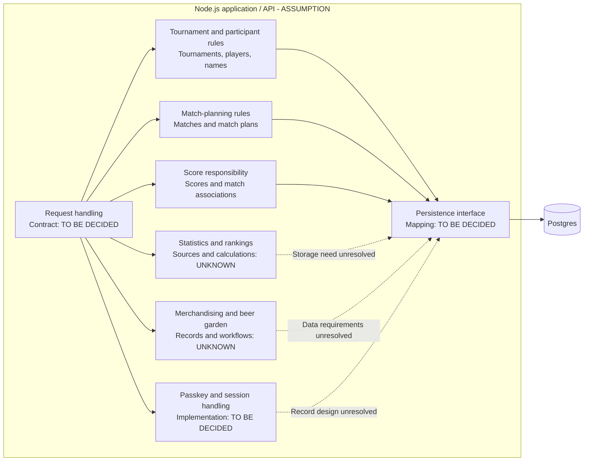
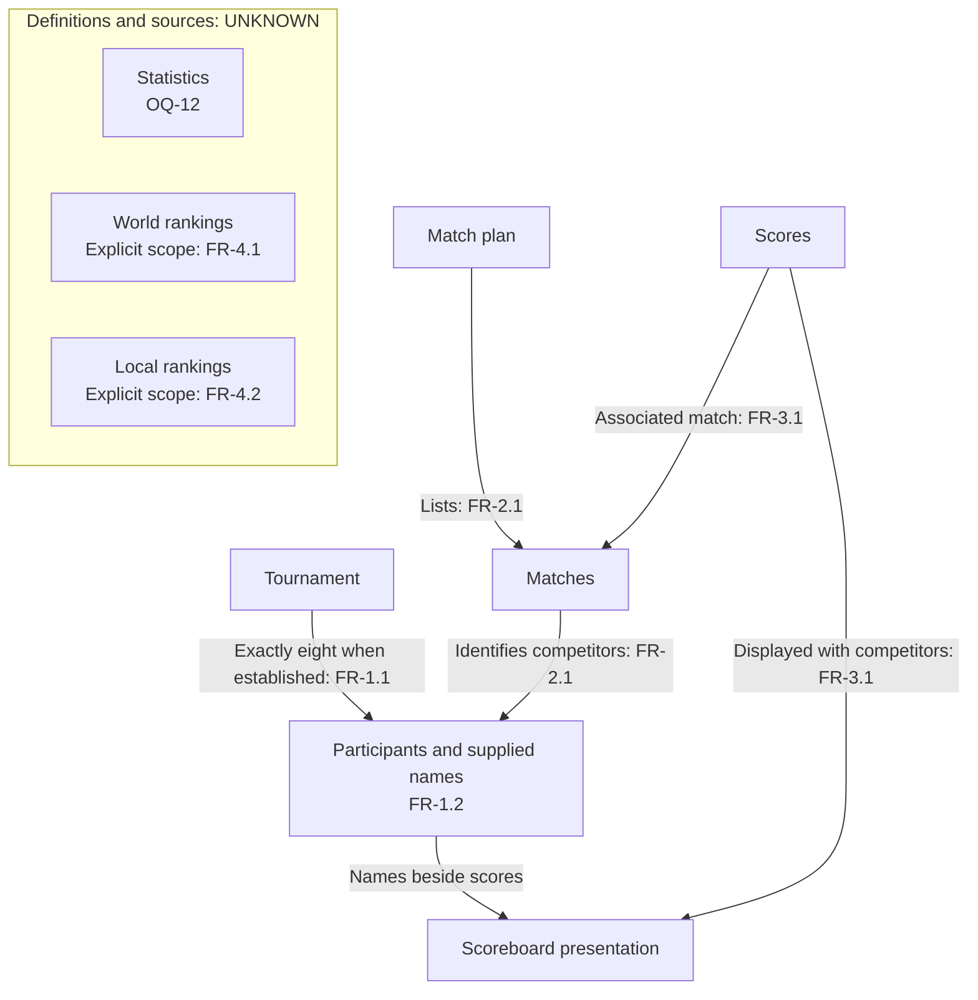
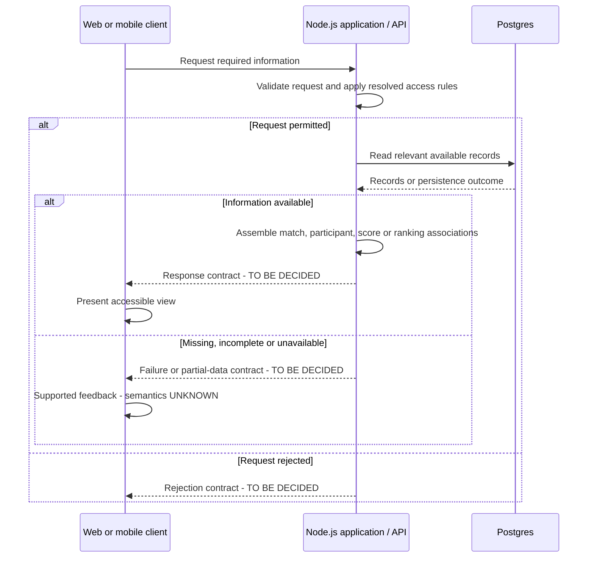
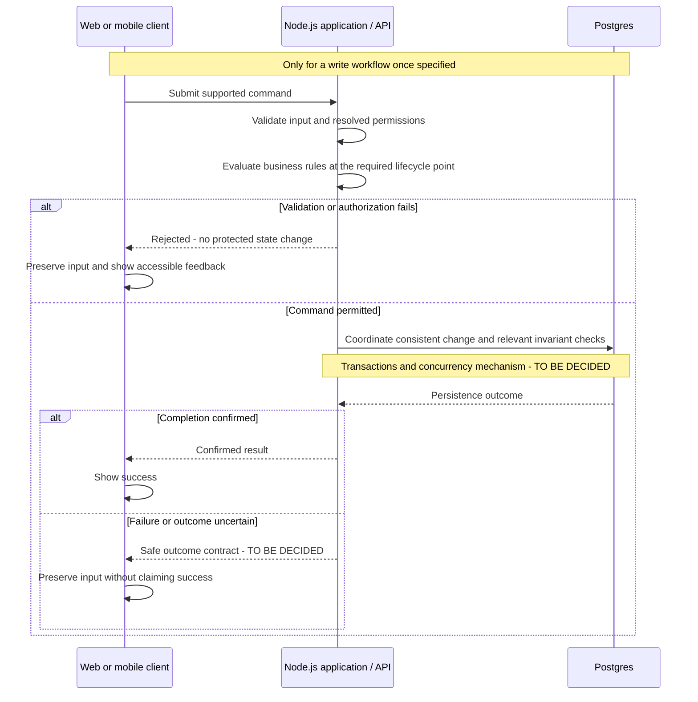
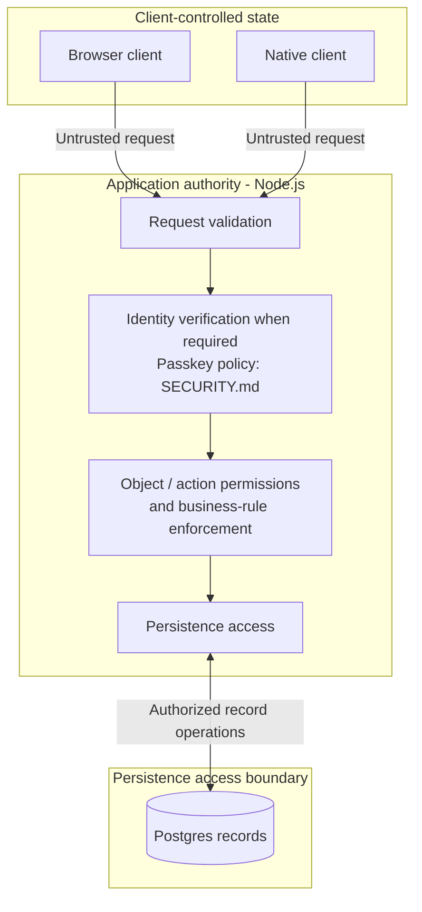
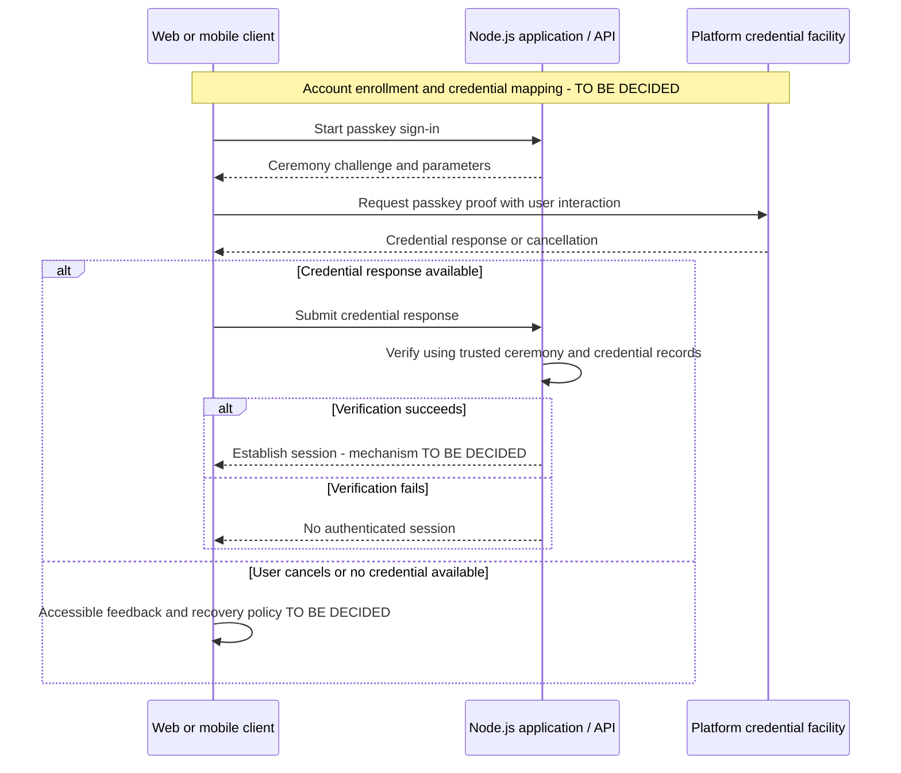
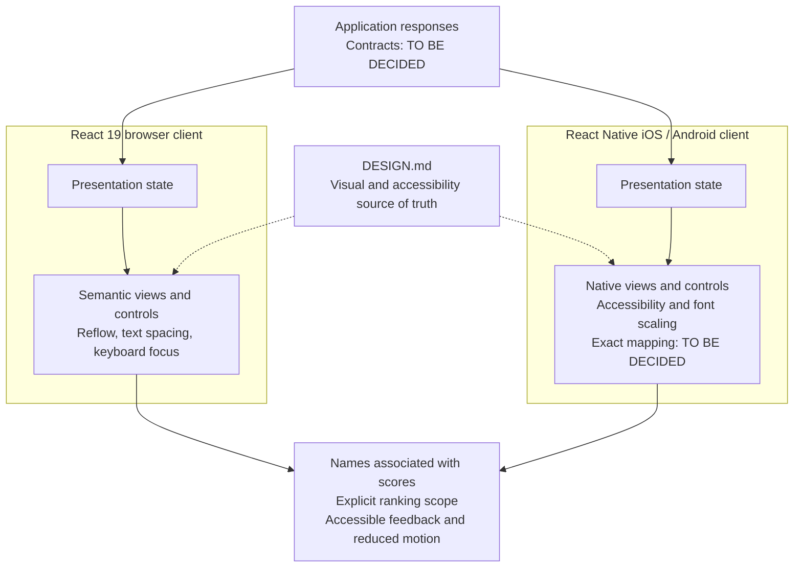

### Required Architecture Inputs

Behavior, actors, workflows, data, and integrations are governed by [REQUIREMENTS.md](REQUIREMENTS.md). Visual language, interaction conventions, accessibility, and frontend capabilities are governed by [DESIGN.md](DESIGN.md). [SECURITY.md](SECURITY.md) owns the security posture and records the subsequently supplied passkey constraint. This document owns implementation structure and technical decisions. It assumes no existing implementation.

- **System purpose:** Manage tennis tournaments with eight players per tournament, including named participants, matches, a scoreboard, statistics, world and local rankings, match planning, merchandising, and beer garden management. Source: `REQUIREMENTS.md`.
- **Primary use cases:** Tournament participation; matches between participants; viewing match plans, scores, and world/local rankings; statistics; merchandising; beer garden management. Detailed workflows beyond the functional requirements are UNKNOWN. Source: `REQUIREMENTS.md`.
- **Target users / actors:** Players, judges, admin, press, trainers, and audience. Responsibilities, permissions, and whether these categories are access-control roles are UNKNOWN. Source: `REQUIREMENTS.md`.
- **Data model expectations:** Tournaments, players and their names, matches, scores, statistics, world rankings, local rankings, and match plans. Established tournament participation contains exactly eight players; plans identify competing participants; scoreboard information associates scores with matches and participants. Merchandising and beer garden records, additional attributes, identity rules, and calculation rules are UNKNOWN. Source: `REQUIREMENTS.md`.
- **Client platforms:** Web, iOS, and Android. Explicit architecture notes resolve the platform choice left TO BE DECIDED in `DESIGN.md`.
- **Web client technology:** React 19, as specified in the architecture notes. Rendering strategy, build tooling, routing, state management, and UI libraries: TO BE DECIDED.
- **Mobile client technology:** React Native for iOS and Android, as specified in the architecture notes. Version, navigation, build/distribution tooling, and native dependencies: TO BE DECIDED.
- **API technology:** Node.js, as specified in the architecture notes. Runtime version, implementation language, server framework, API style, transport, and serialization: TO BE DECIDED.
- **Database technology:** Postgres, as specified in the architecture notes. Version, physical schema, data-access tooling, and migration tooling: TO BE DECIDED.
- **Technology rationale:** The rationale for the four supplied technology choices is UNKNOWN. They are explicit human decisions; other technical choices remain TO BE DECIDED.
- **Frontend and accessibility constraints:** Implement the capabilities and neutral defaults specified by `DESIGN.md`, including its WCAG 2.2 AA target. Brand direction and supported light/dark modes remain TO BE DECIDED.
- **Identity and session handling:** The subsequent human security notes require passkey-only authentication for everyone and encouragement to set up two devices during registration; see `SECURITY.md`. Protected operations, permissions, account-to-player relationships, and session requirements are UNKNOWN. Identity implementation, any separate identity boundary, and session mechanisms: TO BE DECIDED.
- **External integrations:** Required external systems, exchanged data, triggers, and failure behavior are UNKNOWN. Integration architecture: TO BE DECIDED pending requirements.
- **Background processing:** A need for asynchronous jobs or scheduled processing is UNKNOWN. Whether any such processing is needed, and its execution mechanism: TO BE DECIDED pending requirements.
- **Hosting and deployment:** Hosting platform, cloud provider, deployment topology, and release mechanisms: TO BE DECIDED.
- **Operational constraints:** Required capacity, response times, availability, update latency, and recovery objectives are UNKNOWN. Operational mechanisms: TO BE DECIDED.
- **Privacy and regulatory constraints:** Applicable restrictions, retention, and deletion requirements are UNKNOWN. Technical controls dependent on these requirements: TO BE DECIDED.

### Initial Architecture (Provisional)

**ASSUMPTION:** Use four logical components: a React 19 browser client, a React Native mobile client, a Node.js application/API, and Postgres persistence. Both clients access application data through the API. These are proposed responsibility and trust boundaries, not a decided deployment topology or a commitment to independently deployed services. The application owns business decisions; Postgres stores the corresponding records. Component allocation remains TO BE DECIDED.

**Diagram conventions**

Each diagram is an **ASSUMPTION** illustrating the provisional allocation above, except for source-stated technology choices and requirements explicitly identified in its caption. Boxes represent logical responsibilities, not machines, processes, network zones, or independent services. `UNKNOWN` denotes missing input; `TO BE DECIDED` denotes an unresolved choice. A dotted connector denotes a dependency or annotation rather than a runtime message; sequence diagrams use dashed arrows for responses. Captions and adjacent prose provide text equivalents.

**Diagram 1 — Component context and dependency direction**

**ASSUMPTION:** Either client requests application information from Node.js; only the application accesses Postgres. The actor list comes from `REQUIREMENTS.md` and grants no permissions. The four technology choices come from the architecture notes.

**Component name:** Browser client — React 19

- **Responsibility:** **ASSUMPTION:** Present the required tournament, participant, match-plan, scoreboard, and ranking information, delegating authoritative business decisions to the API. Implement web presentation and interactions according to `DESIGN.md`; controls for unresolved workflows await requirements.
- **Inputs:** **ASSUMPTION:** User interactions, API responses, and browser preferences relevant to accessibility and presentation.
- **Outputs:** **ASSUMPTION:** Requests to the API and semantic, responsive views with accessible feedback for supported interactions.
- **Data owned or accessed:** **ASSUMPTION:** Own transient presentation state and any supported in-progress input; access application-supplied records without owning authoritative business data. Persistent client storage and caching: TO BE DECIDED.
- **Open decisions:** Rendering and application structure, routing, state management, request handling, and refresh strategy: TO BE DECIDED. Navigation and editable controls depend on unresolved workflows and permissions in `REQUIREMENTS.md`.

**Component name:** Mobile client — React Native for iOS and Android

- **Responsibility:** **ASSUMPTION:** Provide native presentation of the same resolved information capabilities, using the API for authoritative data and decisions. Apply `DESIGN.md` through appropriate native layout, interaction, and accessibility mechanisms. Capability allocation across web and mobile: TO BE DECIDED.
- **Inputs:** **ASSUMPTION:** User interactions, API responses, and platform text-size, accessibility, and motion preferences.
- **Outputs:** **ASSUMPTION:** API requests and accessible native views and feedback.
- **Data owned or accessed:** **ASSUMPTION:** Own transient presentation state and any supported in-progress input; access application data without owning authoritative records. Persistent local storage and caching: TO BE DECIDED.
- **Open decisions:** Native equivalents for CSS-based sizing, spacing, focus, tables, and text customization; navigation; code sharing with the web client; and refresh strategy: TO BE DECIDED. Offline behavior requirements are UNKNOWN.

**Component name:** Server-side application/API — Node.js

- **Responsibility:** **ASSUMPTION:** Serve both clients through a common application interface, coordinate persistence, and enforce resolved business rules independently of either client. Keep tournament participation, match planning, scores, statistics, and rankings as logical responsibilities within this boundary; their internal module structure is TO BE DECIDED.
- **Inputs:** **ASSUMPTION:** Client read requests, commands only for workflows once specified, and results from persistence operations. External input sources are UNKNOWN.
- **Outputs:** **ASSUMPTION:** Responses carrying the requested information and its associations, persistence operations, and outcomes for any supported commands. Response schemas, error contracts, and unavailable-data representation: TO BE DECIDED.
- **Data owned or accessed:** **ASSUMPTION:** Own the application representation and rules for tournaments, players/names, matches, match plans, scores, statistics, and world/local rankings. Proposed ownership is detailed below; storage is delegated to Postgres. Scoreboard views access match, participant, and score data rather than constituting a separately owned business object.
- **Open decisions:** API contracts, object references, validation, transaction boundaries, concurrency handling, and any authorization enforcement: TO BE DECIDED. Tournament lifecycle, scoring, statistics, and ranking rules remain UNKNOWN where requirements leave them open. Merchandising and beer garden responsibilities cannot be decomposed until their workflows and records are specified.

**Component name:** Data persistence — Postgres

- **Responsibility:** **ASSUMPTION:** Persist application-owned business records and support their retrieval and consistent modification through the application. Use database constraints and transactions to reinforce resolved invariants where appropriate; exact constraints and transaction scope are TO BE DECIDED.
- **Inputs:** **ASSUMPTION:** Reads and writes from the Node.js application and schema changes through a migration mechanism that is TO BE DECIDED.
- **Outputs:** **ASSUMPTION:** Requested records and persistence outcomes returned to the application.
- **Data owned or accessed:** **ASSUMPTION:** Own durable storage of records whose persistence is required, while the application owns their business meaning. Physical tables, keys, relationships, and whether statistics or rankings are stored or derived: TO BE DECIDED.
- **Open decisions:** Schema, indexing, credentials/access controls, migrations, backup/recovery, and retention implementation: TO BE DECIDED. No database design may settle unresolved business rules or invent merchandising or beer garden entities.

**Business-object ownership and rule enforcement**

Every allocation in this table is an **ASSUMPTION**, proposed within the Node.js application rather than as a separate service. Ownership concerns the application's representation of data; whether any source is externally authoritative is UNKNOWN.

| Business objects | Proposed logical owner | Rule or unresolved dependency |
| --- | --- | --- |
| Tournaments, players, player names, tournament participation | Tournament and participant responsibility | Enforce FR-1.1 and FR-1.2 server-side. The lifecycle point for checking eight participants, name validation, and duplicate-name identity remain unresolved; see requirements OQ-3–OQ-5. |
| Matches and match plans | Match-planning responsibility | Preserve associations between each listed match and its participants under FR-2.1. Format, plan origin, scheduling fields, and permitted changes remain unresolved; see OQ-1, OQ-2, OQ-8, and OQ-9. |
| Scores | Score responsibility | Supply match and participant associations for FR-3.1. Input sources, validation, corrections, scoring rules, and freshness remain unresolved; see OQ-10 and OQ-11. |
| Statistics | Statistics responsibility | Definitions, sources, calculation, scope, and presentation are UNKNOWN; see OQ-12. No computation or storage strategy is selected. |
| World rankings and local rankings | Ranking responsibility | Preserve explicit world/local scope for FR-4.1 and FR-4.2. Ranked entities, local boundary, source, calculation, and refresh rules remain unresolved; see OQ-13 and OQ-14. |
| Merchandising and beer garden data | Application responsibility; internal ownership TO BE DECIDED | Business objects and operations are UNKNOWN; see OQ-15 and OQ-16. |

**Diagram 2 — Application responsibilities and ownership**

**ASSUMPTION:** Requests are handled within one logical application boundary. Domain responsibilities own business meaning; a persistence interface coordinates access to stored records. The passkey constraint adds identity handling, provisionally inside the same application. Identity records, credential metadata, and session representation are TO BE DECIDED; accounts are not assumed to be player records. No internal layer or authentication library has been selected.

**Diagram 3 — Required information relationships**

The associations below trace FR-1.1 through FR-4.2. **ASSUMPTION:** They form the conceptual information view delivered by the application, not a table schema or entity-cardinality specification. Eight applies to established tournament participation; match format and opponents per match remain UNKNOWN. Statistics and rankings have no assumed dependency on scores.

**Primary flows and interfaces**

1. **ASSUMPTION — reads:** A client requests required information; the API obtains the available records from persistence, assembles their required relationships and ranking scope, and returns a response for the client to present. Endpoint organization, wire format, and handling of missing or partial data are TO BE DECIDED. This flow does not establish where scores or rankings originate.
2. **ASSUMPTION — conditional writes:** If a workflow is specified to change data, a client submits the supported command; the API validates it against resolved business and permission rules, applies the corresponding persistence operation, and returns its outcome. The client preserves input on errors and shows success only after confirmed completion, as required by `DESIGN.md`. This proposal does not authorize any currently unspecified editing workflow.
3. **ASSUMPTION — integrity:** Validate the eight-player invariant at the server-side lifecycle boundary once requirements define it. Coordinate relevant persistence changes consistently so that client input or concurrent changes cannot bypass the resolved invariant. Enforcement timing, rejection behavior, and concurrency mechanism are TO BE DECIDED.

Update delivery, score entry, plan generation, statistical computation, and ranking ingestion are TO BE DECIDED pending the corresponding requirements. No polling, push delivery, background job, or external service has been selected.

**Diagram 4 — Read request and response**

**ASSUMPTION:** A permitted read reaches persistence through the API and returns data with the associations required by the requested view. Read permissions and unavailable-data behavior remain unresolved. Repeated reads, polling, and live updates are not implied.

**Diagram 5 — Conditional mutation and invariant enforcement**

**ASSUMPTION:** Once a write workflow is defined, the API evaluates its permissions and rules, coordinates a consistent persistence operation, and returns an outcome. The eight-player check belongs at the lifecycle point specified by future requirements, not at an invented preparation or start state. Transaction scope and concurrent-update strategy are TO BE DECIDED.

**Trust boundaries**

- **ASSUMPTION — client to application:** Treat data from either client as untrusted. The application validates requests and remains the enforcement point for resolved business rules. Client-side checks and hidden controls cannot confer authority. Passkey-only policy comes from the subsequent security notes recorded in `SECURITY.md`; verification placement is provisional, and authorization and session mechanisms remain TO BE DECIDED. Actor categories alone do not establish permissions.
- **ASSUMPTION — application to persistence:** Only the application accesses business records through the proposed runtime data interface; clients do not receive database credentials or connect directly to Postgres. Connection security, database privileges, and operational access mechanisms are TO BE DECIDED.
- Required identity services and external integrations are UNKNOWN. No separate identity component, integration adapter, external vendor, or background-processing boundary is established. If requirements identify an external system, its authority, exchanged data, validation, and failure contract must be resolved before specifying that boundary.

**Diagram 6 — Trust transitions and enforcement placement**

**ASSUMPTION:** Client assertions cross into application-controlled decisions before any protected record access. Persistence has its own access boundary. These enclosures describe authority, not an approved network topology; detailed controls belong to `SECURITY.md`.

**Diagram 7 — Passkey interface allocation**

The passkey-only policy and two-device encouragement are explicit subsequent security inputs. **ASSUMPTION:** Platform credential facilities mediate the client ceremony and Node.js performs server verification within the existing API boundary. This illustration shows sign-in after enrollment; account bootstrap, native associations, credential storage, session format, and recovery remain TO BE DECIDED. The platform facility is not a selected external identity vendor. Verification rules are owned by `SECURITY.md`.

**Frontend implementation obligations**

- **ASSUMPTION:** Implement reusable presentation primitives in each client to apply the tokens, typography, layout, logo treatment, and interaction conventions owned by `DESIGN.md`. Shared token/code packaging and UI tooling are TO BE DECIDED. The design's neutral defaults do not settle brand or supported modes.
- Web implementation must support semantic headings and data relationships, explicit world/local labels, unambiguous name/score association, wrapping player names, responsive reading order, and labeled scrolling regions for essential two-dimensional data. Support 200% text resizing, reflow at 320 CSS pixels, and user text-spacing overrides as specified by `DESIGN.md`.
- Both clients must expose programmatic names, roles, states, labels, and data relationships; support keyboard operation with logical, visible, unobscured focus; and respect reduced-motion preferences. Apply the design's contrast and target-size requirements. **ASSUMPTION:** Native accessibility APIs, font scaling, and platform-appropriate layouts provide the mobile equivalents; their exact mapping to the web-oriented design specifications is TO BE DECIDED.
- For supported inputs, preserve visible labels and entered values, associate textual errors with fields, provide linked summaries for multiple errors, and announce relevant feedback without unexpected focus movement. Feedback must not rely on color alone. Missing-data meaning is UNKNOWN; contract and presentation choices await requirements rather than substituting zero. Dynamic-update delivery and announcement behavior remain TO BE DECIDED.
- Verify WCAG 2.2 AA expectations across complete implemented workflows, including keyboard and assistive-technology use. Platform-specific verification methods and tooling are TO BE DECIDED.

**Diagram 8 — Frontend adaptation and accessibility**

**ASSUMPTION:** Each client adapts application responses into presentation state and platform-specific accessible primitives. `DESIGN.md` supplies the presentation and accessibility requirements, including keyboard operation, text resizing, reflow, contrast, and reduced motion. Shared code and native equivalents are TO BE DECIDED; the diagram does not select a UI library or introduce new screens.

