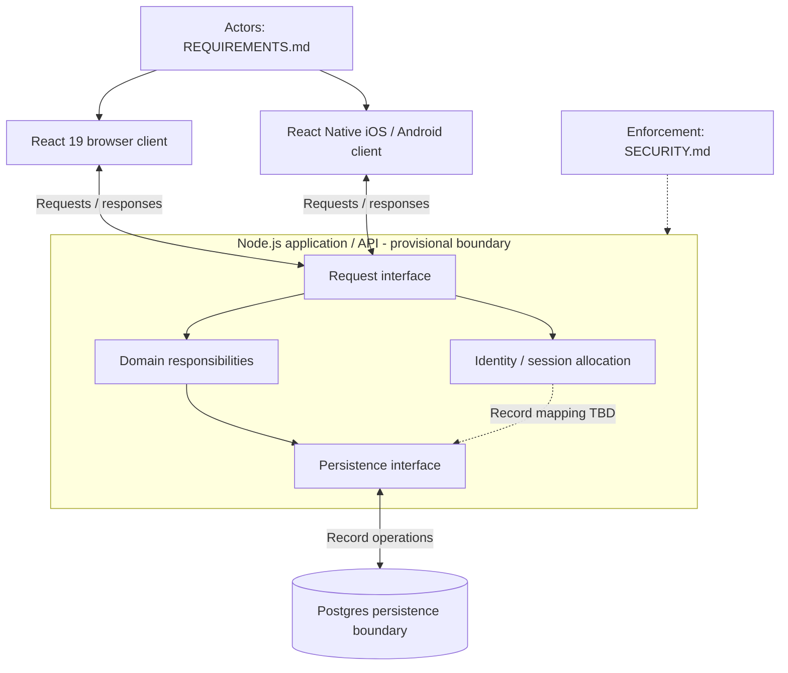
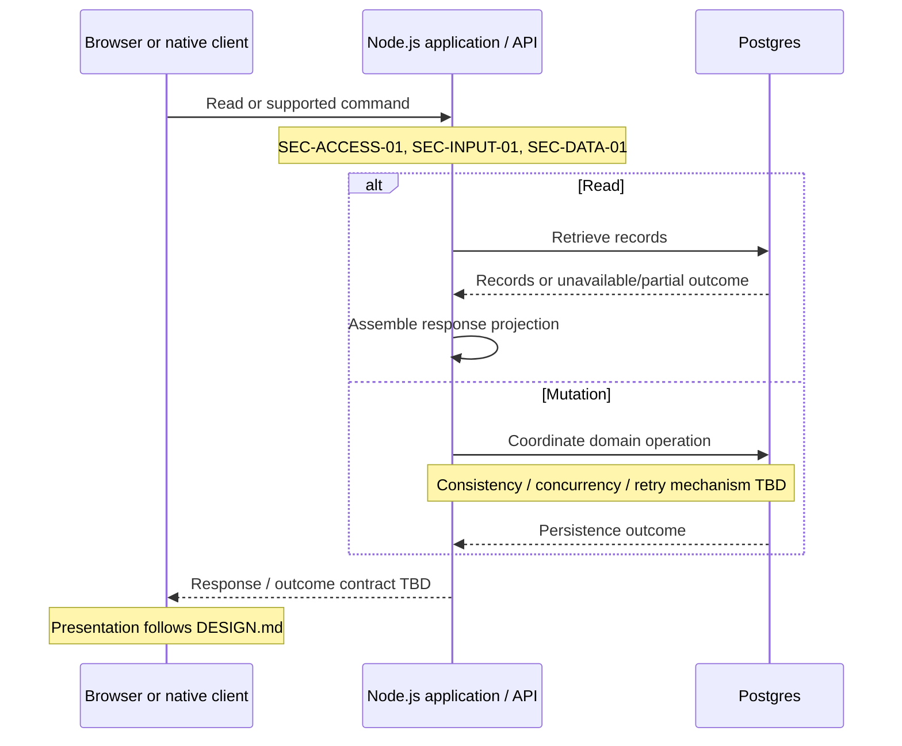
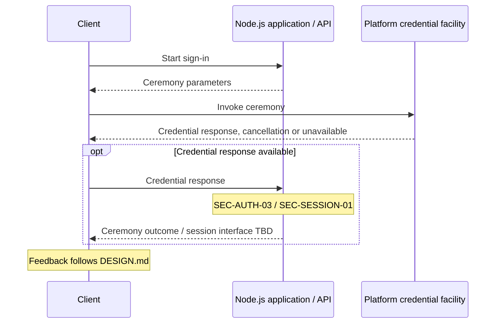

# Architecture

This document owns implementation structure, components, interfaces, data-flow and trust-boundary topology, technology choices and rationale. Product purpose, actors, business records, workflows and integrations: [REQUIREMENTS.md](REQUIREMENTS.md). Visual/frontend and accessibility specifications: [DESIGN.md](DESIGN.md). All security posture, enforcement and privacy controls: [SECURITY.md](SECURITY.md). Agent setup, build/test and release guidance: [AGENTS.md](AGENTS.md). No implementation is assumed.

## Selected Technologies

| Area | Supplied choice | Remaining decisions |
| --- | --- | --- |
| Client platforms | Web, iOS and Android | Capability allocation across clients, supported OS/browser versions: TO BE DECIDED |
| Browser | React 19 | Minor version, rendering strategy, build tooling, routing, state management, UI libraries: TO BE DECIDED |
| Mobile | React Native | Version, navigation, build/distribution tooling, native dependencies and code sharing: TO BE DECIDED |
| Application/API | Node.js | Runtime version, implementation language, framework, API style, transport and serialization: TO BE DECIDED |
| Persistence | Postgres | Version, physical schema, data access and migration tooling: TO BE DECIDED |

These are explicit human architecture choices. Their historical rationale is UNKNOWN; no rationale is inferred. Security reference version labels do not select additional runtime/language versions; see [source applicability](SECURITY.md#security-posture).

## Provisional Components and Boundaries

**ASSUMPTION:** Four logical responsibilities: browser client, mobile client, application/API and persistence. Both clients use the application interface; the application uses Postgres. These are proposed responsibility and trust boundaries, not machines, network zones, independently deployed services or a decided deployment topology. Allocation remains TO BE DECIDED. All enforcement obligations are linked to their security owner; an assumed placement does not make a required control optional.

Diagram conventions: boxes are logical responsibilities; arrows are runtime exchanges, dashed sequence arrows are responses, and dotted flow connectors are dependencies/annotations. `UNKNOWN` denotes missing historical facts and `TO BE DECIDED` unresolved choices. Captions and accessible descriptions provide text equivalents.

| Component | Proposed inputs, outputs and ownership | Open implementation decisions |
| --- | --- | --- |
| Browser client — React 19 | User interactions, API responses and browser preferences → presentation state, views and API requests. Owns transient state and supported in-progress input; consumes application records. | Rendering/application structure, request handling, refresh strategy, persistent storage and caching: TO BE DECIDED. Presentation contract: [DESIGN.md](DESIGN.md). |
| Mobile client — React Native | User interactions, API responses and platform preferences → native views, feedback and API requests. Owns transient state/in-progress input; consumes application records. | Navigation, code sharing, persistent local storage/caching and offline mechanisms: TO BE DECIDED, subject to [product questions](REQUIREMENTS.md#open-questions). |
| Server-side application/API — Node.js | Client reads/commands and persistence outcomes → response records/outcomes and persistence operations. Proposed owner of business representation and domain coordination; scoreboard is a projection of match/participant/score data, not a separately owned business object. | Internal modules, object references, contracts/schemas, error and missing/partial-data representation, transaction boundaries, concurrency, idempotency and outcome reconciliation: TO BE DECIDED. Controls: [SECURITY.md](SECURITY.md#controls-and-trust-boundary-enforcement). |
| Data persistence — Postgres | Application reads/writes and migration operations → durable records and persistence outcomes; application owns business meaning. | Tables, keys, relationships, indexing, constraints, transaction scope, migrations, statistics/ranking materialization and recovery mechanisms: TO BE DECIDED. Grants, connection protection, backups and retention controls: [SECURITY.md](SECURITY.md). |

### Domain Allocation and Conceptual Relationships

Every allocation is an **ASSUMPTION**, within Node.js rather than a separate service. Physical schema is not selected; unresolved external source authority remains a product question.

| Proposed responsibility | Records / relationships | Behavior owner |
| --- | --- | --- |
| Tournament/participant | Tournament to participation and supplied names | [FR-1.1–1.3](REQUIREMENTS.md#tournament-participation) |
| Match planning | Plan to listed matches to competing participants | [FR-2.1–2.2](REQUIREMENTS.md#matches-and-match-plan) |
| Scores | Scores/results to matches/participants; scoreboard projection | [FR-3.1–3.2](REQUIREMENTS.md#scoreboard) |
| Statistics | Completed-result projection per tournament/participant; stored versus derived strategy TO BE DECIDED | [FR-5.1](REQUIREMENTS.md#tournament-statistics) |
| Rankings | World/local representations; no inferred dependency on scores | [FR-4.1–4.2 and OQ-13/14](REQUIREMENTS.md#world-and-local-rankings) |
| Merchandising | Catalog, stock adjustments, sales and sale-line snapshots | [FR-6.1–6.3](REQUIREMENTS.md#merchandising) |
| Beer garden | Menu, orders/lines, terminal state and sales | [FR-7.1–7.4](REQUIREMENTS.md#beer-garden) |
| Identity/session | Account, credential metadata and session representation; record mapping/storage TO BE DECIDED | [SEC-AUTH-01–04, SEC-SESSION-01](SECURITY.md#security-requirements) |

### Read and Mutation Interfaces

**ASSUMPTION:** The application assembles read projections and coordinates mutations through a persistence interface. Endpoint organization, wire format, validation adapters, refresh delivery, polling/push, transaction/locking/idempotency methods and status lookup contract are TO BE DECIDED. Data origins, plan generation and ranking ingestion follow [requirements decisions](REQUIREMENTS.md#open-questions); no external service or background job is selected.

### Identity Interface

**ASSUMPTION:** Platform credential facilities mediate ceremonies and verification is allocated inside Node.js. This does not select an external identity vendor or library. Account enrollment/bootstrap, native associations, credential storage, session representation and recovery mechanisms remain TO BE DECIDED under [SEC-AUTH-01–04](SECURITY.md#security-requirements).

### Frontend Adaptation

**ASSUMPTION:** API responses feed separate browser/native presentation state and reusable platform presentation primitives. Shared token/code packaging and UI tooling: TO BE DECIDED. Browser semantic primitives and native accessibility APIs/font scaling are proposed adapters to [DESIGN.md](DESIGN.md), whose defaults do not settle brand or mode choices. Native equivalents for CSS sizing/spacing, focus, tables, text customization, contrast, keyboard and motion behavior, and platform-specific verification tooling: TO BE DECIDED. Dynamic update delivery and presentation announcement mapping depend on their respective requirements/design owners.

## Remaining Architecture Decisions

- Integration architecture, adapters, exchanged interfaces and any external trust boundary: TO BE DECIDED after [OQ-17](REQUIREMENTS.md#open-questions). No external identity service, integration adapter or worker is established. Boundary authority/validation/failure controls belong to [SECURITY.md](SECURITY.md).
- Need and mechanism for async/scheduled processing: TO BE DECIDED against [OQ-19](REQUIREMENTS.md#open-questions).
- Hosting platform/provider, deployment/network topology, TLS termination, native associations, operational access paths and release mechanisms: TO BE DECIDED; operational/security constraints belong to [SECURITY.md](SECURITY.md) and workflow guidance to [AGENTS.md](AGENTS.md).
- Capacity, latency, availability and recovery mechanisms: TO BE DECIDED against [nonfunctional questions](REQUIREMENTS.md#open-questions). Privacy-dependent storage, encryption/key management, backup access and deletion mechanisms: TO BE DECIDED against [security decisions](SECURITY.md#open-security-questions).
